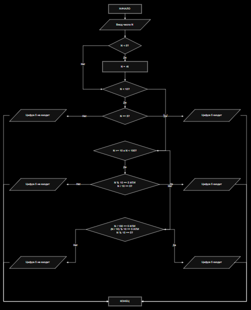

# Лаба 6
# Вариант 6
###Условие Дано число N (N<1000). Написать программу, которая проверяет входит ли в него цифра 5




# Код

```c
#include <stdio.h>

int homework() {
    int N;

    puts("Введите число N (N < 1000):");
    scanf("%d", &N);

    if (N < 0) N = -N;

    if (N < 10) {
        if (N == 5)
            printf("Цифра 5 входит в число %d", N);
        else
            printf("Цифра 5 не входит в число %d", N);
    }

    if (N >= 10 && N < 100) {
        if (N % 10 == 5 || N / 10 == 5)
            printf("Цифра 5 входит в число %d", N);
        else
            printf("Цифра 5 не входит в число %d", N);
    }

    if (N >= 100) {
        if (N / 100 == 5 || (N / 10) % 10 == 5 || N % 10 == 5)
            printf("Цифра 5 входит в число %d", N);
        else
            printf("Цифра 5 не входит в число %d", N);
    }

    return 0;
}
```
